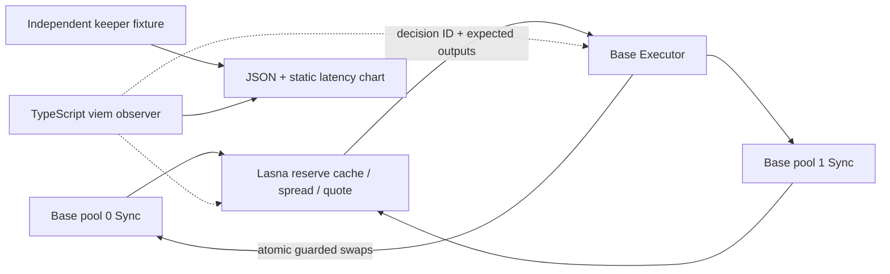

# Slipstream

**An event-driven two-pool arbitrage prototype with a reproducible latency bench.**
Two fixed-liquidity test-token AMMs on Base Sepolia feed a Lasna reactive contract.
When cached reserves show sufficient spread and quoted profit, it requests an atomic
two-swap callback. Moving token0 through the higher-price pool and back through the
lower-price pool brings prices closer while retaining positive token0 profit.

## Why Reactive

An AMM emits state changes but cannot initiate its own next transaction. Slipstream
uses Reactive to turn those events into authenticated execution without a dedicated
application keeper. The arbitrage itself is possible with a keeper; that is why this
project includes an actual polling baseline. Whether Omni is faster, and by how much,
is an empirical question. Live observations are reported below with their exact experimental scope.



## Safety and measurement

- Executor requires callback proxy plus the configured reactive contract address;
  owner can pause and withdraw test inventory only while paused.
- Fixed input cap, per-leg expected-output slippage bounds, deadline and final
  minimum token0 profit. A failed second leg rolls back the first atomically.
- Decisions are keyed by origin chain/tx/log index. Repeated callbacks are no-ops;
  out-of-order reserve updates are discarded by pool sequence number. Executor-origin
  Syncs update the cache but do not recursively trigger more trades.
- Test tokens have fixed supply and no hooks or transfer fees. Pools have no LP
  redemption mechanism and are purpose-built fixtures, not production AMMs.
- The observer runs the budgeted number of real dislocations per mode on independent fixtures. It joins
  source tx → Decision → Completed, records failure denominators, p50/p95 and stage
  timestamps, then exports a self-contained HTML chart. It never fabricates data.

Trade profit is in token0 before gas; dislocation trading costs are not revenue.
Stale reserve snapshots can reject callbacks, and rejected callbacks still cost gas.
The contracts do not prove a persistent arbitrage opportunity or mainnet profitability.
See DEPLOY for observer timing limitations and the actual keeper comparison protocol.

```sh
npm ci --ignore-scripts --cache .npm-cache
npm run typecheck
npm test
npm run measure # help only; no transaction
```

## Transaction evidence — live testnet

| Loop | Base origin | Lasna reactive | Base callback |
|---|---|---|---|
| 1 | [0x74aa40157d772c7a83681f433346418ea845249a3f3c6859158e7a9c5ba6a1ab](https://sepolia.basescan.org/tx/0x74aa40157d772c7a83681f433346418ea845249a3f3c6859158e7a9c5ba6a1ab) | [0xbfed731647e9e2d6ae5f051941c948b8e8ef651128600969c8287abbbea68415](https://lasna.reactscan.net/tx/0xbfed731647e9e2d6ae5f051941c948b8e8ef651128600969c8287abbbea68415) | [0xe0b2877d81e7dd297effe78ee2f97dc13d01bb7e8355d525ede3eea5968fa057](https://sepolia.basescan.org/tx/0xe0b2877d81e7dd297effe78ee2f97dc13d01bb7e8355d525ede3eea5968fa057) |
| 2 | [0xfe8ef82064c8702063661b48550e2033e74bcef232837533faf2d47871f7e9b8](https://sepolia.basescan.org/tx/0xfe8ef82064c8702063661b48550e2033e74bcef232837533faf2d47871f7e9b8) | [0x84e5d823436422d3aac1119c2c54fa984aced781acb3c28ff292013b54913d3a](https://lasna.reactscan.net/tx/0x84e5d823436422d3aac1119c2c54fa984aced781acb3c28ff292013b54913d3a) | [0x71aeea8eeba98a44135fbc1cbc63fe68287c8f743a8be06c933ae96b4eb2fb42](https://sepolia.basescan.org/tx/0x71aeea8eeba98a44135fbc1cbc63fe68287c8f743a8be06c933ae96b4eb2fb42) |
| 3 | [0xe825fb455047c12901fdb623e6841aff53cef1766fc6e52163928584943c41d3](https://sepolia.basescan.org/tx/0xe825fb455047c12901fdb623e6841aff53cef1766fc6e52163928584943c41d3) | [0x5f1e2b6bb89166c199342f86f848578bfb689fe7311b9091a0fdc8a9308be5fa](https://lasna.reactscan.net/tx/0x5f1e2b6bb89166c199342f86f848578bfb689fe7311b9091a0fdc8a9308be5fa) | [0x4f393b714751f6c24d246b3ff1ad04f84d76d0db23cae6536f15584ec1d50013](https://sepolia.basescan.org/tx/0x4f393b714751f6c24d246b3ff1ad04f84d76d0db23cae6536f15584ec1d50013) |

All three calibration Reactive loops emitted Completed and returned completed(id)=true. [Full transaction ledger](measurements/TRANSACTIONS.md) lists every attempted trial, including keeper executions; [machine evidence](config/evidence.json) retains all hashes and state checks.

| Fixture / contract | Network | Address |
|---|---|---|
| Reactive | Lasna | [0x7509221859d2984ed941f671b616c6a77d07c95b](https://lasna.reactscan.net/address/0x7509221859d2984ed941f671b616c6a77d07c95b) |
| reactiveFixture / token0 | Base Sepolia | [0xeaa82c47cd2d4a7b86fcf4034c277969bd60441e](https://sepolia.basescan.org/address/0xeaa82c47cd2d4a7b86fcf4034c277969bd60441e) |
| reactiveFixture / token1 | Base Sepolia | [0xa3294e7467357ce2c1f00d065f8eca0dd3593739](https://sepolia.basescan.org/address/0xa3294e7467357ce2c1f00d065f8eca0dd3593739) |
| reactiveFixture / pool0 | Base Sepolia | [0xb1df4394c6f89eac075ce138e1a503c4c89f5bed](https://sepolia.basescan.org/address/0xb1df4394c6f89eac075ce138e1a503c4c89f5bed) |
| reactiveFixture / pool1 | Base Sepolia | [0x4870b5b9fbdd6b9f134905828cccf0cbead45b9b](https://sepolia.basescan.org/address/0x4870b5b9fbdd6b9f134905828cccf0cbead45b9b) |
| reactiveFixture / executor | Base Sepolia | [0xff70c3f9bce166fe0406d1cb74ed6c4b7fd292b6](https://sepolia.basescan.org/address/0xff70c3f9bce166fe0406d1cb74ed6c4b7fd292b6) |
| keeperFixture / token0 | Base Sepolia | [0x582aabdafc830f6540846bdaa925df4c79a3cf77](https://sepolia.basescan.org/address/0x582aabdafc830f6540846bdaa925df4c79a3cf77) |
| keeperFixture / token1 | Base Sepolia | [0xac9a51e4f86e01c2bf812a958b0242aea5afcc7c](https://sepolia.basescan.org/address/0xac9a51e4f86e01c2bf812a958b0242aea5afcc7c) |
| keeperFixture / pool0 | Base Sepolia | [0x6c391e50784a5630860c5afd9194b72174843276](https://sepolia.basescan.org/address/0x6c391e50784a5630860c5afd9194b72174843276) |
| keeperFixture / pool1 | Base Sepolia | [0xa0c27683a0c44a11a78dc82bfbc8f87dc3dd4364](https://sepolia.basescan.org/address/0xa0c27683a0c44a11a78dc82bfbc8f87dc3dd4364) |
| keeperFixture / executor | Base Sepolia | [0xa039dd21f4a46b05b0e0b95152290a733e061a1d](https://sepolia.basescan.org/address/0xa039dd21f4a46b05b0e0b95152290a733e061a1d) |

### Budget and actual sample counts

Budget permits **139 trials per mode**: 3 calibration + 136 formal, rather than 200 + 200. The 3 calibration Reactive round costs were 0.0393263, 0.0393233, 0.0393263 lREACT, including the decision and both callback-induced Sync updates. The authorized 0.03 Base Sepolia ETH faucet request delivered 3 lREACT. We reserved 0.5 lREACT for Heartbeat and 0.02 lREACT for funding/shutdown gas. The additional count is the largest integer satisfying `floor((wallet + current Reactive balance - 0.5 - 0.02) / max(calibration round cost))`, capped at the remaining target. Heartbeat contract residual is not spendable by Slipstream. See [budget inputs](evidence/slipstream-budget.json) and [per-execution fee traces](evidence/slipstream-cost-calibration.json).

| Dataset | Mode | Successful / attempted | p50 observed ms | p95 observed ms | Same-chain block p50 / p95 s |
|---|---|---|---:|---:|---|
| calibration | reactive | 3/3 | 5351.8 | 5400.8 | 1 / 2 |
| calibration | keeper | 3/3 | 19842.5 | 95611.8 | 18 / 88 |
| formal | reactive | 136/136 | 436.4 | 4319.4 | 2 / 2 |
| formal | keeper | 136/136 | 8303.6 | 9185.6 | 8 / 9 |

Formal run complete. Calibration used a receipt-waiting broadcaster and its timing distribution is **not pooled** with the formal run. The formal observer runs concurrently with the offline forge signer. Node never receives the private key. It checks Completed, two Base confirmations, completed(id), and settlement of both Reactive reserve sequences. The viem clients retain their 4000 ms block-number cache/default polling interval, while the observer loop sleeps 500 ms. Source and callback may be discovered in one cached-block poll; near-zero observed intervals are not proof of subsecond protocol latency. Public RPC transport and polling remain part of observed latency; the keeper is this configured 2-second confirmed-origin poller, not the fastest possible keeper. Fixtures continue from settled calibration with alternating direction offset 3. No mainnet or universal protocol-speed conclusion is claimed.

[Calibration JSON](measurements/27cf3990-b267-476d-ab01-b8b3586a117a.json) · [calibration chart](measurements/27cf3990-b267-476d-ab01-b8b3586a117a.html) · [formal JSON](measurements/8ef50d60-a2a2-40dd-a66e-0408c426059a.json) · [formal chart](measurements/8ef50d60-a2a2-40dd-a66e-0408c426059a.html).

The static HTML reports use real rows only. Browser visual preview could not run because the browser access host was unavailable. This workspace measurement uses `../tools/live.py` and `../heartbeat/script/Sign.s.sol` as an external signer; those helpers must accompany a standalone copy or be replaced with an equivalent secure signer.

## Build and verification

```sh
python tools/bootstrap.py
forge test -vv
```

Windows: `./tools/test.ps1` finds user-local Foundry even when it is absent from PATH.
The build used existing Foundry 1.8.6 in the user's .foundry/bin (no installation or
Hardhat fallback needed), Solidity 0.8.30, optimizer and via-IR. Dependencies are pinned
by commit in `dependencies.lock.json`; application contracts have no sibling imports; the workspace signer dependency is documented above.
See [TESTLOG.md](TESTLOG.md) for actual passing logs and a deliberately broken invariant.
Contracts have been deployed and live-tested. See
[DEPLOY.md](DEPLOY.md), [SOURCES.md](SOURCES.md) and [VIDEO-SCRIPT.md](VIDEO-SCRIPT.md).

Our source is MIT; upstream dependencies retain their terms (see SOURCES).
AI-assisted implementation; the live testnet acceptance evidence is recorded above. Self-review is not an independent security audit.
